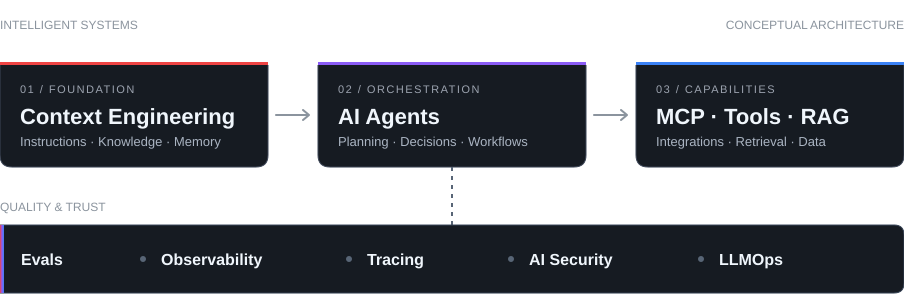
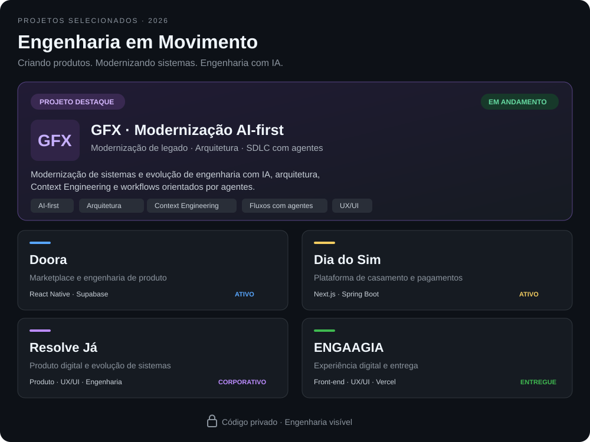

   
  
  
  

 
Sou <strong>Desenvolvedor de Software especializado em Front-end</strong>, com atuação em <strong>Arquitetura de Software, Full Stack e UX/UI Design</strong>. Conecto engenharia, design e visão de produto para criar experiências digitais consistentes.

Valorizo **código limpo, decisões arquiteturais bem fundamentadas e sistemas fáceis de manter e evoluir**. A inteligência artificial é parte essencial do meu processo de desenvolvimento, ampliando possibilidades sem substituir qualidade, fundamentos técnicos ou pensamento crítico.

 

 
<strong>Front-end &amp; Design</strong>

**Back-end & Engineering**

**Complementares:** Framer · Supabase · APIs REST · Integrações · Design Systems · CI/CD

 

 
Adoto uma abordagem <strong>AI-first de ponta a ponta</strong>, da concepção da arquitetura à implementação, aos testes e à entrega. Com <strong>Context Engineering, Agent Harnesses, RAG, MCP e agentes</strong>, estruturo fluxos que integram contexto, conhecimento e ferramentas ao trabalho de engenharia.

No **AI-assisted SDLC**, utilizo avaliações, observabilidade, práticas de segurança e **Human-in-the-loop** para orientar automações e manter as decisões técnicas verificáveis e sob responsabilidade humana.

 

