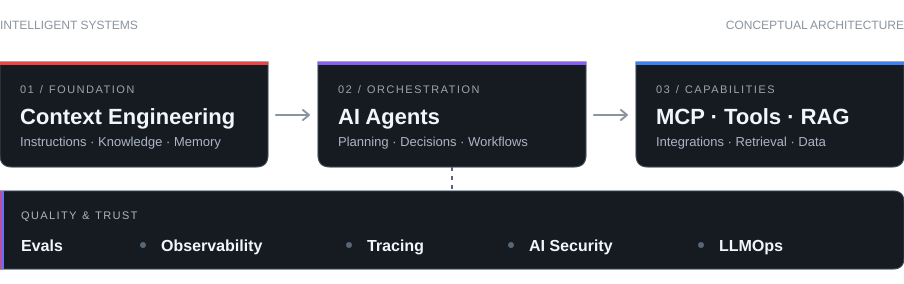

###  Sobre mim

Sou **Desenvolvedor de Software especializado em Front-end**, com atuação em **Arquitetura de Software, Full Stack e UX/UI Design**. Conecto engenharia, design e visão de produto para criar experiências digitais consistentes.

Valorizo **código limpo, decisões arquiteturais bem fundamentadas e sistemas fáceis de manter e evoluir**. A inteligência artificial é parte essencial do meu processo de desenvolvimento, ampliando possibilidades sem substituir qualidade, fundamentos técnicos ou pensamento crítico.

###  Tech Stack

**Front-end & Design**

**Back-end & Engineering**

**Complementares:** Framer · Supabase · APIs REST · Integrações · Design Systems · CI/CD

###  AI Engineering

Adoto uma abordagem **AI-first de ponta a ponta**, da concepção da arquitetura à implementação, aos testes e à entrega. Com **Context Engineering, Agent Harnesses, RAG, MCP e agentes**, estruturo fluxos que integram contexto, conhecimento e ferramentas ao trabalho de engenharia.

No **AI-assisted SDLC**, utilizo avaliações, observabilidade, práticas de segurança e **Human-in-the-loop** para orientar automações e manter as decisões técnicas verificáveis e sob responsabilidade humana.

