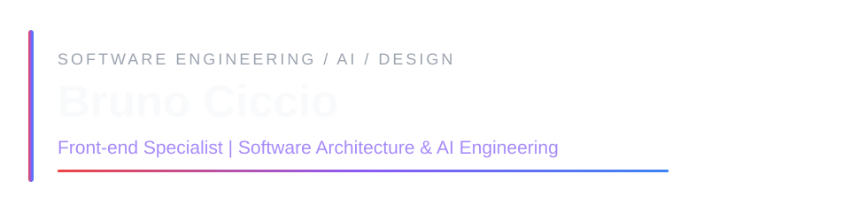
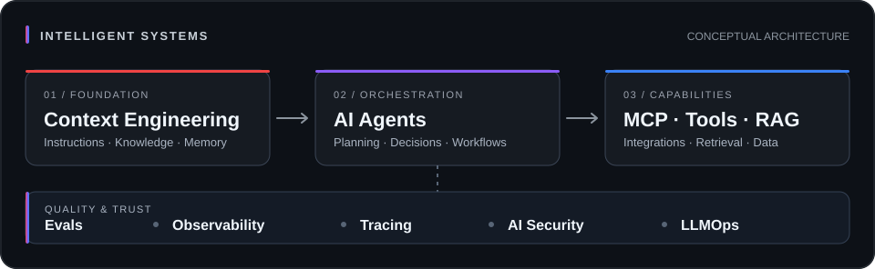
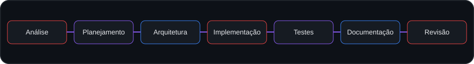

## Sobre mim

Sou **Desenvolvedor de Software, especialista em Front-end**, com atuação em **Arquitetura de Software, AI Engineering, desenvolvimento Full Stack e UX/UI Design**.

Trabalho na concepção, arquitetura e evolução de produtos digitais, conectando engenharia de software, experiência do usuário e inteligência artificial. Minha atuação abrange interfaces, APIs, integrações, modernização de sistemas e soluções baseadas em LLMs.

Tenho experiência com **React, Angular, TypeScript, Node.js e Java/Spring Boot**, design systems e prototipação avançada com **Figma e Framer**.

## Áreas de atuação

| Especialidade | Foco |
| :--- | :--- |
| **Front-end Engineering** | React, Angular, TypeScript, arquitetura de interfaces, componentização e design systems. |
| **Software Architecture & Full Stack** | APIs, integrações, serviços com Node.js e Java/Spring Boot e modernização de sistemas. |
| **AI Engineering** | LLMs, RAG, MCP, Tool Calling, agentes, avaliações, observabilidade e segurança. |
| **UX/UI & Product Design** | Jornadas, prototipação, experiência do usuário e integração entre design e engenharia. |

## Tecnologias e ferramentas

**Front-end & Design**

**Back-end & Engineering**

**Competências complementares:** Framer · APIs REST · Integrações · CI/CD · Design Systems · Context Engineering · LLMOps

## AI Engineering

Desenvolvo soluções com LLMs e agentes, integrando conhecimento, ferramentas, avaliação e observabilidade. A arquitetura considera segurança, confiabilidade e capacidade de evolução desde a concepção.

<b>Explorar competências em inteligência artificial</b>

- **LLMs e RAG:** integração de modelos e recuperação contextual de conhecimento.
- **Tool/Function Calling e MCP:** conexão com ferramentas, serviços e fontes de dados.
- **Agents, Agent Harnesses e Agentic Workflows:** orquestração de tarefas, contexto e execução.
- **Context Engineering:** organização de instruções, ferramentas, restrições e conhecimento.
- **Evals, Observability e Tracing:** avaliação, rastreabilidade e diagnóstico.
- **AI Security e LLMOps:** segurança, governança e operação de sistemas de IA.
- **Fine-tuning:** estratégias de adaptação e especialização de modelos.

## AI-first Software Engineering

Aplico IA ao ciclo de desenvolvimento de software (**SDLC**), com agentes apoiando atividades de engenharia sob critérios técnicos, testes e revisão humana.

Estruturo esses fluxos com **Context Engineering, Agent Harnesses e Agentic Workflows**, priorizando documentação, rastreabilidade, qualidade e responsabilidade técnica.

## Experiência e projetos

- **GFX:** modernização de sistema legado com um workflow AI-first de ponta a ponta e práticas reutilizáveis.
- **Conector, Resolve Já, AruVox, STIR/SHAKEN e Portal Core v3:** atuação em Front-end, UX/UI, integrações, Full Stack e evolução de produtos.

Projetos corporativos descritos em nível geral, sem exposição de código, dados ou arquitetura interna não públicos.

## Atividade no GitHub

Visualização de serviço externo, sujeita a indisponibilidade. [Consultar contribuições diretamente no GitHub](https://github.com/brunociccio?tab=overview).

## Reconhecimentos

- **1º lugar — NEXT 2023** · Digital Innovation (Porto & FIAP)
- **1º lugar — Global Solution 2024** · Inovação Azul (Oceans 20 e parceiros)

## Formação

- **Análise e Desenvolvimento de Sistemas** — FIAP
- **MBA em UX/UI com IA** — Em andamento
- **Pós-graduação em Engenharia de Software aplicada à IA** — Em andamento

### Vamos nos conectar?

Front-end Engineering · Software Architecture · AI Engineering · Product Design

